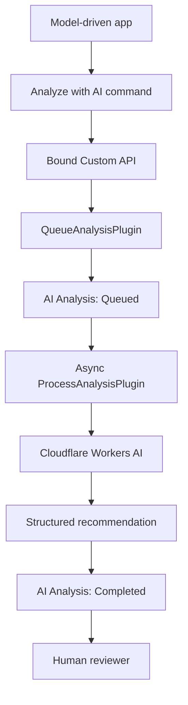

# Dataverse AI Record Assistant

A working MVP that adds AI-assisted review to a Microsoft Dataverse model-driven app. A reviewer can analyze a training-course application, receive a structured recommendation, and keep the final business decision under human control.

## What it does

The solution turns a manual application review into a traceable, asynchronous workflow:

1. A user opens a `Training Course Application` and selects **Analyze with AI**.
2. A bound Dataverse Custom API invokes `QueueAnalysisPlugin`.
3. The plug-in creates a related `AI Analysis` record with status `Queued`.
4. An asynchronous `ProcessAnalysisPlugin` captures an input snapshot and calls Cloudflare Workers AI.
5. The structured response is validated, mapped to Dataverse fields, and marked `Completed` or `Failed`.
6. The recommendation remains separate from the application record, so a human reviewer retains control of the decision.



The completed analysis stores:

- AI summary and decision reason
- Suggested decision: Approve, Request corrections, Manual review, or Reject
- Risk level: Low, Medium, or High
- Confidence score and missing information
- Input snapshot, analyzed date, status, and error details for traceability

The original demonstration captures are not committed because they contain environment and user identifiers. See [the screenshot checklist](docs/images/README.md) before adding redacted versions. All application data shown in the demo is fictional.

## Technology

- Microsoft Power Apps model-driven app
- Microsoft Dataverse tables, forms, relationships, Choices, and Custom API
- C# Dataverse plug-ins targeting .NET Framework 4.6.2
- Asynchronous Dataverse plug-in step
- JavaScript command-bar web resource
- Cloudflare Workers AI REST API with JSON Mode

## Repository structure

```text
.
├── .github/workflows/ci.yml
├── DataverseAIRecordAssistant.sln
├── docs/
│   ├── images/
│   └── setup.md
├── src/
│   ├── DataverseAIRecordAssistant.Plugins/
│   │   ├── PluginBase.cs
│   │   ├── QueueAnalysisPlugin.cs
│   │   └── ProcessAnalysisPlugin.cs
│   └── DataverseAIRecordAssistant.WebResources/
│       ├── ai-sparkle.svg
│       └── queueAnalysis.js
└── tests/webresources/
```

This repository contains the custom code and portfolio documentation. It does not currently include an importable Dataverse solution package.

## Build and test

Prerequisites:

- Visual Studio 2022 or a current .NET SDK capable of building `net462`
- Node.js 20 or later for the dependency-free web-resource tests

```powershell
dotnet restore DataverseAIRecordAssistant.sln --locked-mode
dotnet build DataverseAIRecordAssistant.sln --configuration Release --no-restore
npm test
```

The repository does not commit a private strong-name key. A normal clone therefore produces an unsigned validation build. Before registering the plug-in assembly, create or supply a protected `.snk` file and build with:

```powershell
dotnet build DataverseAIRecordAssistant.sln --configuration Release -p:SignAssembly=true -p:AssemblyOriginatorKeyFile=C:\secure\DataverseAIRecordAssistant.Plugins.snk
```

Never store a release-signing key in source control.

## Configure Dataverse

The source uses the `lyr_` publisher prefix and matching logical column names. If the target environment uses another schema, update the constants and web-resource metadata before registering the assembly.

Follow [docs/setup.md](docs/setup.md) for the tables, Choice values, Custom API, plug-in steps, command-bar wiring, and secure Cloudflare configuration.

The asynchronous step's **Secure Configuration** uses this format:

```text
AccountId=<CLOUDFLARE_ACCOUNT_ID>;ApiToken=<CLOUDFLARE_API_TOKEN>;Model=@cf/meta/llama-3.1-8b-instruct-fast
```

## Security and responsible use

- No API token, Account ID, signing key, or environment-specific URL is tracked.
- Credentials belong in Dataverse secure step configuration, never in JavaScript or source control.
- Only data required for the analysis should be sent to an external AI provider.
- Treat record content as untrusted prompt input and validate every model response.
- Review privacy, retention, regional processing, and organizational AI-governance requirements before using real personal data.
- AI output is advisory and must be validated by an authorized reviewer.

See [SECURITY.md](SECURITY.md) for operational guidance and vulnerability reporting.

## Current scope

The MVP demonstrates the end-to-end integration and failure tracing. Useful next improvements include idempotency and retry handling, automated C# tests, explicit accept/override actions, prompt and model version tracking, processing-duration metrics, and an exportable managed Dataverse solution.

## License

Licensed under the [MIT License](LICENSE).

